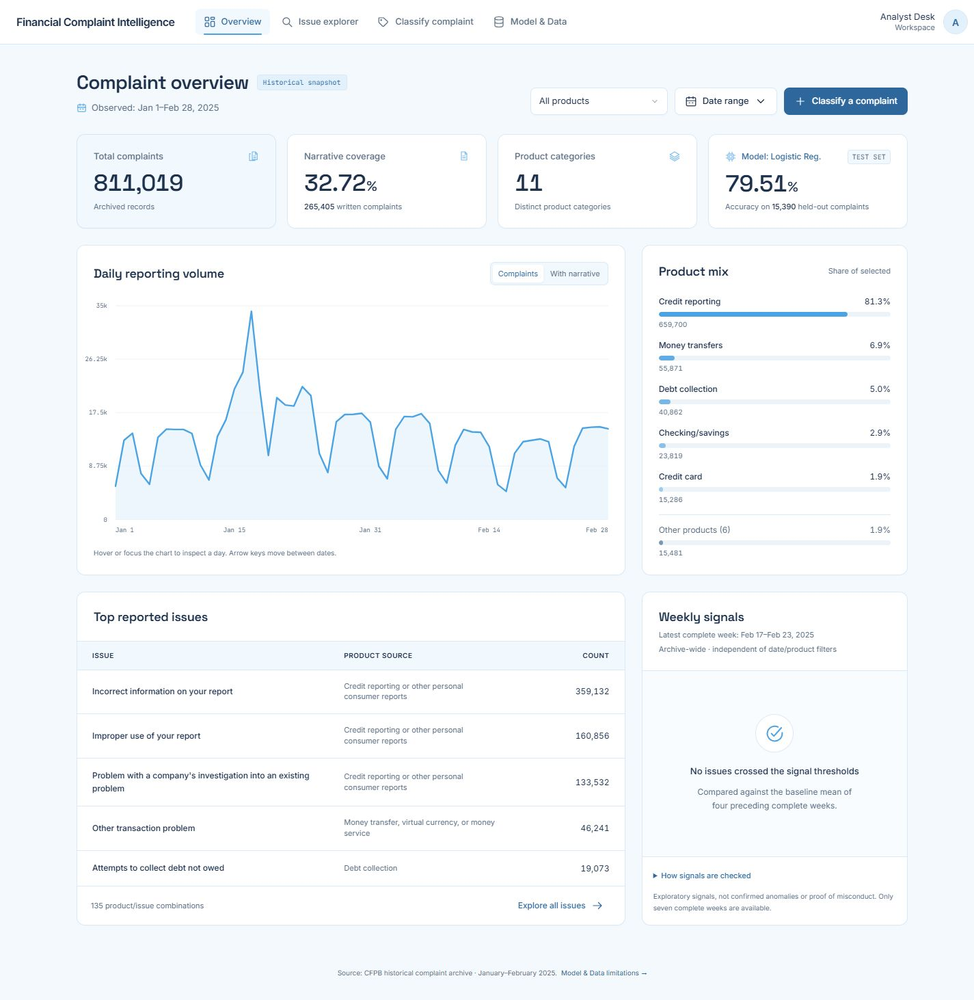
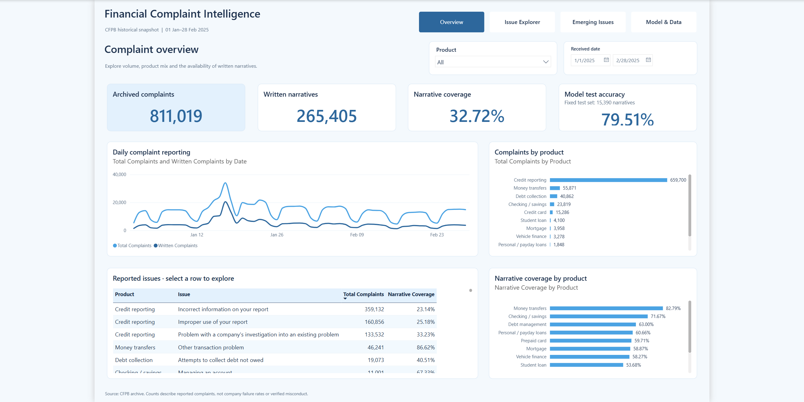

# Financial Complaint Intelligence

An analytics and NLP project for exploring financial complaint reporting, investigating issues and reviewing model-assisted product classification. It includes a sky-blue web dashboard and a separate four-page Power BI report.

**Live demo:** [Open Financial Complaint Intelligence](https://complaint-intelligence-mk.vercel.app/). The frontend loads from Vercel and shows a sky-blue connection screen while the existing Render analysis server wakes up.

**Backend / previous link:** [Render dashboard and API](https://financial-complaint-intelligence.onrender.com) remains available. [Split-hosting verification](docs/SPLIT_HOSTING_VERIFICATION.json).

**Power BI:** [download the report](powerbi/Financial_Complaint_Intelligence.pbix) · [report guide](powerbi/README.md) · [deployment instructions](docs/DEPLOYMENT.md).

## Start the dashboard

1. Extract the complete ZIP if using the archive.
2. Double-click **Start_Dashboard.cmd** on Windows.
3. Open **http://127.0.0.1:8765** if the browser does not open automatically. Keep the console window open; press **Ctrl+C** there to stop.

Python **3.12 or 3.13** is required. The launcher reuses a matching environment or creates a project-local .dashboard-env and installs the pinned requirements. Internet access is needed for that first setup. The included model, counts, fonts and interface then run locally without a dataset download, account or API key.

**The model is already trained. Do not rerun Colab to open the dashboard.**

Manual setup from this project folder:

    python -m venv .venv
    .\.venv\Scripts\python.exe -m pip install -r requirements.txt
    .\.venv\Scripts\python.exe api.py

## Working features

- **Overview:** date/product filters, daily complaint and narrative charts, keyboard/mouse chart inspection, product mix, leading issues and weekly signals.
- **Issue Explorer:** search, sorting, pagination, issue details with daily trends and CSV exports preserving the selected dates, product and search.
- **Classify Complaint:** real saved-model inference, three ranked product matches, explicitly uncalibrated scores, a human-review route, input validation and illustrative examples. Entered text is not saved by the application.
- **Model & Data:** fixed test metrics, chronological splits, validation-based selection, all 11 per-category reports, an interactive confusion matrix, source provenance and limitations.
- Responsive sky-blue layout, visible keyboard focus, restrained transitions and reduced-motion CSS. Fonts and icons are served locally.
- **Power BI:** native Overview, Issue Explorer, Emerging Issues and Model & Data pages, with Power Query imports, relationships, 36 DAX measures and interactive slicers. Open the PBIX in Power BI Desktop; no cloud account or model retraining is needed.

## Verified results

| Measure | Result |
|---|---:|
| Archived analytics records | 811,019 |
| Records with written narratives | 265,405 |
| Narrative coverage | 32.72% |
| Unique eligible narratives after deduplication | 126,736 |
| Uncapped training / validation / test rows | 101,935 / 9,411 / 15,390 |
| Selected model | TF-IDF + Logistic Regression |
| Held-out test accuracy | 79.51% |
| Held-out test macro-F1 | 0.6672 |

All-record analytics and narrative-only modeling use different populations. The uncapped run uses all eligible training-window narratives, rather than all 811,019 archive rows.

Train: **January 1–February 9**; validation: **February 10–16**; test: **February 17–28, 2025**. The vocabulary is fitted on training text only. Normalized text is retained once before splitting. IDs and normalized hashes do not overlap across partitions; other near-duplicates may remain.

Selection uses **validation macro-F1**. The uncapped validation macro-F1 of 0.6572 modestly improved on the capped run's 0.6539 with identical holdouts. Capped test accuracy/macro-F1: 78.42%/0.6580. Uncapped: 79.51%/0.6672. This is an observed improvement, not a statistical-significance claim.

The returned uncapped Colab ZIP was checked and imported. All 15,390 predictions and scores were independently reproduced from the saved model and original held-out text in the development workspace.

## Data and signals

Source: [CFPB official historical narratives archive](https://www.consumerfinance.gov/foia-requests/foia-electronic-reading-room/cfpb-consumer-complaint-database-narratives-archive/), **January–February 2025**. The fixed source checksum is recorded in the pipeline and data manifest.

The portable dashboard file contains **5,024 date/product/issue aggregate rows**, with no complaint text or identifiers. The large raw archive and SQLite database are excluded from delivery.

Signals compare a complete week with four preceding complete weeks. All four rules must hold: current issue count ≥30; baseline weekly mean ≥5; volume ≥1.5 times baseline; archive-wide share increase ≥0.5 percentage points. Partial weeks are excluded. **No issues crossed these thresholds in the three evaluable historical weeks.** Latest complete week: February 17–23, 2025.

The signal panel is explicitly archive-wide and independent of analytics filters. Model evaluation also stays fixed when analytics filters change.

Historical complaints are self-selected and unverified. Counts are reporting activity, not company failure rates or proof of misconduct. Scores are uncalibrated. Signals are exploratory, not statistically confirmed anomalies. Smaller categories have lower performance and limited support.

## Reproduce the project

Financial_Complaint_Intelligence_Colab.ipynb is the v3 uncapped notebook. It downloads/checks the official archive, builds SQLite, runs SQL, cleans/deduplicates text, trains baselines and candidates, selects on validation and exports results.

For a fresh Colab run, keep **PROFILE = "uncapped"** and use a normal CPU runtime. If setup says **ONE SESSION RESTART IS REQUIRED**, choose **Runtime → Restart session**, then run all cells again from the top. Confirm **101,935 / 9,411 / 15,390** train/validation/test counts. Preserve earlier archives and import only your own generated ZIP:

    .\.venv\Scripts\python.exe import_results.py "C:\path\to\Financial_Complaint_Results_uncapped.zip"

To rebuild only the portable analytics, without training:

    .\.venv\Scripts\python.exe prepare_dashboard.py

This downloads/checks the archive and builds SQLite if needed, then exports the aggregate counts. The delivered counts are already included, so rebuilding is optional.

## Project map

| Location | Purpose |
|---|---|
| dashboard/ | HTML/CSS/JavaScript application and local fonts/icons |
| api.py | Dashboard, filtered analytics, CSV and model-serving endpoints |
| dashboard_data.py | Aggregate-only data preparation and filtering |
| launch_dashboard.py, Start_Dashboard.cmd | Startup and matching-environment setup |
| complaint_project.py | Source verification, SQLite, analytics and modeling |
| sql/business_analysis.sql | Six queries using CTEs, joins and window functions |
| models/uncapped/ | Selected verified model, routing and checksum |
| models/full/, models/smoke/ | Preserved comparison/smoke artifacts |
| reports/uncapped/ | Colab metrics, splits, predictions and figures |
| reports/analytics/dashboard_analytics.json | Portable dashboard counts |
| reference/ | Capped-run metrics and exact holdout fingerprints |
| tests/ | Pipeline, runtime, leakage, filters, CSV and API checks |
| docs/ | User guide, verification, model/data card and walkthrough |
| powerbi/ | Native PBIX, editable PBIP/TMDL/PBIR source, aggregate inputs and page screenshots |
| render.yaml | Free-tier web service, startup command, health check and hosted processing mode |
| .github/workflows/checks.yml | Linux dependency, Python test and browser-script checks |

## Verification and boundaries

The development workspace passed **40 automated checks**, including independent SQLite comparisons for filtered reporting, CSV round trips, real inference and fixed evaluation behavior. Browser QA covered the four views, filters, keyboard chart controls, issue search/sort/pagination/details, an actual CSV download, prediction/review/error cases, category sorting, confusion-matrix interaction and responsive layouts.

    .\.venv\Scripts\python.exe -m pip install -r requirements-dev.txt
    .\.venv\Scripts\python.exe -m pytest tests -q
    .\.venv\Scripts\python.exe launch_dashboard.py --check

Three raw-SQL comparison cases skip in the portable delivery because SQLite is intentionally excluded. Rebuild with prepare_dashboard.py to enable them. Reduced-motion CSS is included; no OS preference change was performed during QA.

The original local implementation passed the checks above. The publication copy additionally passed **40 tests with 3 raw-database comparisons skipped**, including hosted processing disclosure and real inference. Linux Python 3.13 wheels for the runtime requirements were downloaded successfully. The GitHub workflow checks the portable project on Ubuntu.

The deployed service passed **11 live HTTP checks** covering source totals, filtered counts, CSV export, real inference, validation errors, hosted processing disclosure, static assets and the public Power BI download. All four live browser views were inspected; issue searching and an actual credit-report prediction were exercised. See [live verification](docs/LIVE_VERIFICATION.json) for the recorded results. GitHub Actions status is shown in the repository's Actions tab and is separate from those completed local and live checks.

The native Power BI report was opened and saved in Desktop; all four pages were reviewed and six native DAX queries passed. Source validation returned zero errors and one warning because a Microsoft schema URL emitted by Desktop was unavailable. Details are recorded under `powerbi/docs/`.

This repository excludes raw narratives, complaint-level membership/prediction exports, the large SQLite database, Python environments and private account state. See [repository contents](docs/REPOSITORY_CONTENTS.md) for the delivery boundaries. The dashboard runs from the saved model and historical aggregates without an external data connection. Azure and Databricks are not part of this project's implementation.

